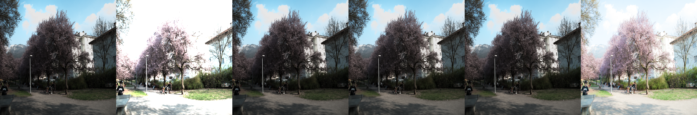
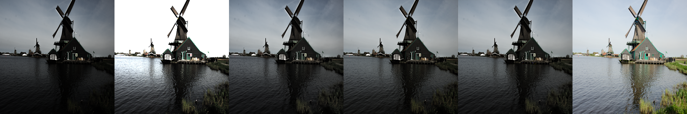
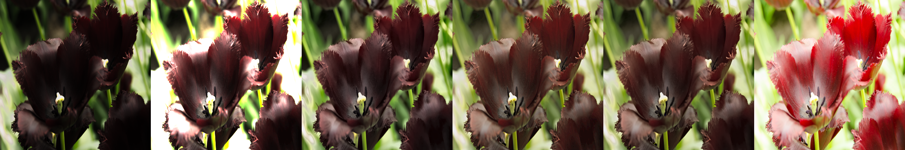
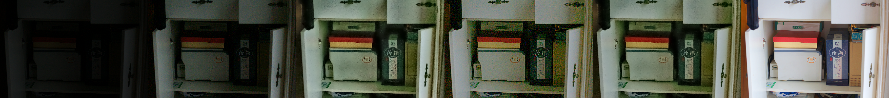

# Failure-case analysis (hybrid method)

Worst 5 images by **PSNR** (lowest = worst). Failure tags are derived automatically from measured diagnostics; the written causes in `docs/design.md` summarise them.

## r05772356t

*Panels: input | input x4 (for visibility) | classical | deep learning | hybrid | ground truth*

- PSNR 8.20 dB, SSIM 0.552, NIQE 3.78, noise suppression x1.0, edge preservation 0.75, mean output luma 0.38
- Input diagnostics: mean luma 0.358, noise sigma 0.0098, non-uniformity 0.79, colour cast 0.07
- **Detected failure modes:** residual / amplified noise, strongly non-uniform lighting in input

## r01170470t

*Panels: input | input x4 (for visibility) | classical | deep learning | hybrid | ground truth*

- PSNR 10.27 dB, SSIM 0.631, NIQE 2.65, noise suppression x1.0, edge preservation 0.81, mean output luma 0.35
- Input diagnostics: mean luma 0.264, noise sigma 0.0022, non-uniformity 1.00, colour cast 0.05
- **Detected failure modes:** residual / amplified noise, strongly non-uniform lighting in input

## r03193652t

*Panels: input | input x4 (for visibility) | classical | deep learning | hybrid | ground truth*

- PSNR 10.52 dB, SSIM 0.616, NIQE 3.24, noise suppression x0.7, edge preservation 0.85, mean output luma 0.33
- Input diagnostics: mean luma 0.206, noise sigma 0.0013, non-uniformity 1.00, colour cast 0.25
- **Detected failure modes:** colour shift, residual / amplified noise, strongly non-uniform lighting in input

## r0341853dt

*Panels: input | input x4 (for visibility) | classical | deep learning | hybrid | ground truth*

- PSNR 10.85 dB, SSIM 0.674, NIQE 2.91, noise suppression x0.5, edge preservation 0.94, mean output luma 0.35
- Input diagnostics: mean luma 0.175, noise sigma 0.0025, non-uniformity 1.00, colour cast 0.02
- **Detected failure modes:** residual / amplified noise, strongly non-uniform lighting in input

## 55

*Panels: input | input x4 (for visibility) | classical | deep learning | hybrid | ground truth*

- PSNR 11.54 dB, SSIM 0.614, NIQE 3.26, noise suppression x2.4, edge preservation 0.86, mean output luma 0.36
- Input diagnostics: mean luma 0.039, noise sigma 0.0035, non-uniformity 0.60, colour cast 0.10
- **Detected failure modes:** extremely dark input
